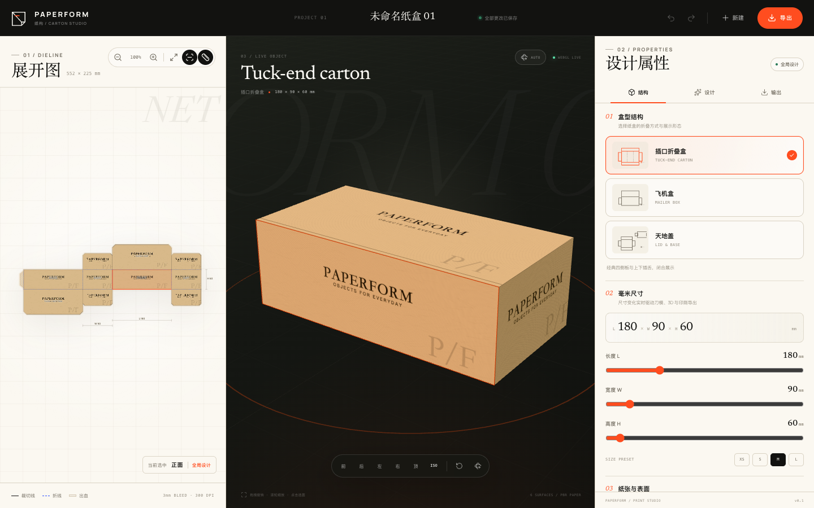

# PAPERFORM / 纸构

浏览器端纸盒设计工作台：左侧实时展开刀模图，中间可拖拽的 3D 纸盒，右侧完成盒型、毫米尺寸、纸张与每面印刷设计。



## 功能

- **三种盒型**：插口折叠盒、飞机盒（可开盖）、天地盖（可升盖）。
- **2D 展开图**：SVG 刀模线、钴蓝折线、3mm 出血、安全区、尺寸标注、面名称、滚轮缩放与拖拽平移。
- **3D 预览**：Three.js 棚拍光与接触阴影，拖拽旋转、滚轮缩放、六个视角预设、点选面、自动旋转；开盒后内壁使用纸色内衬，不会出现反向印刷。
- **专业属性面板**：
  - 长 / 宽 / 高、天地盖高度与间隙、纸张材料、厚度、表面工艺。
  - 全局设计 + 单面覆盖；可将当前面同步到所有面。
  - 底色、纸纹、8 种印刷图案、整面图片（铺满/适应 + 缩放/位移/旋转）。
  - 多文字与 Logo 图层，支持字体、字重、字号、字距、行高、对齐、透明度、旋转与位置。
  - 四套视觉模板。
- **导出**：含出血的 300dpi 印刷 PDF（贴图页 + 矢量刀模页）、高清 PNG、可编辑 SVG、工程 JSON。
- **工程保存**：IndexedDB 自动保存，刷新继续编辑；30 步撤销 / 重做；JSON 导入导出。

## 快速开始

环境：Node.js ≥ 22.12，pnpm ≥ 10。

```bash
pnpm install
pnpm dev
```

打开终端输出的 `http://127.0.0.1:5173/`。

### 验证命令

```bash
pnpm test
pnpm typecheck
pnpm build
# 或一次执行全部：pnpm check
```

### 浏览器验收

先运行 `pnpm dev`，再执行：

```bash
node scripts/browser-check.mjs
```

脚本使用本机 Google Chrome（macOS 路径），覆盖 1440/1280 布局、尺寸联动、撤销重做、单面覆盖、图片上传、3D 拖拽、刷新恢复、四种导出与工程导入。

## 导出样例

- [印刷 PDF](docs/samples/paperform-sample-print.pdf)
- [高清展开图 PNG](docs/samples/paperform-sample-dieline.png)
- [编辑用 SVG 刀模](docs/samples/paperform-sample-dieline.svg)
- [工程 JSON](docs/samples/paperform-sample-project.json)

PDF 第一页为 300dpi 贴图，第二页为矢量刀模、折线、出血与尺寸说明。

## 技术结构

```
src/
  core/
    boxes/       三种盒型的展开图与 3D 面几何
    exporters/   PDF / PNG / SVG / JSON
    artworkCanvas.ts   毫米级 Canvas 贴图合成
    netSvg.ts          SVG 刀模序列化
    textureCache.ts    2D / 3D 共用纹理缓存
    project.ts         默认工程、全局/单面继承
  components/
    NetViewer.vue
    BoxViewer.vue
    PropertyPanel.vue
    property/    结构、设计、输出面板
  stores/designer.ts
```

技术栈：Vue 3、TypeScript、Vite、Pinia、Three.js、jsPDF、Vitest。

## 已知边界

- 纯前端工具，无账号、云端同步与多人协作。
- 工程只保存在当前浏览器 IndexedDB；换设备请导出 JSON。
- 刀模参数、纸张纹向与印刷工艺需要印厂复核；本项目输出设计交付文件，不替代结构工程签样。
- 超大盒型导出会按最长边像素上限降级，界面与导出面板均有说明。

详细验收记录见 [docs/verification.md](docs/verification.md)。
